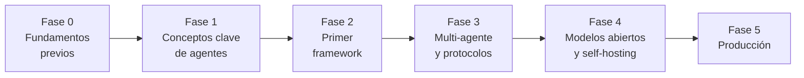

# Curso de Agentes de IA

**Material de estudio personal — enfoque en sistemas open source**

Un learning path completo para aprender a construir agentes de IA desde cero: primero los fundamentos (LLMs, prompting, tool calling), después la teoría del agent loop, y por último frameworks, multi-agente, modelos abiertos y producción. Todo con herramientas de código abierto.

## Las fases

| Fase | Duración | Temas principales | Documento |
|------|----------|-------------------|-----------|
| **0 — Fundamentos previos** | 1–2 semanas | Python intermedio, LLMs, prompting, tool calling, APIs REST | [Fundamentos de LLMs, Prompting y Tool Calling](fundamentos-llms-prompting-toolcalling.md) |
| **1 — Conceptos clave de agentes** | 2–3 semanas | Agent loop, ReAct, Plan-and-Execute, herramientas, memoria, MCP, RAG | [Fundamentos de LLMs, Prompting y Tool Calling](fundamentos-llms-prompting-toolcalling.md) |
| **2 — Primer framework** | 2–4 semanas | smolagents, CrewAI, LangGraph | [Fase 2 — Primer framework](fase-2-primer-framework.md) |
| **3 — Multi-agente y protocolos** | 3–4 semanas | Orquestación, A2A, MCP en profundidad, Microsoft Agent Framework, Google ADK | [Fase 3 — Multi-agente](fase-3-multiagente-protocolos.md) |
| **4 — Modelos abiertos y self-hosting** | 2–4 semanas | Ollama, vLLM, Qwen/Llama/DeepSeek/Mistral, evaluación con Promptfoo | [Fase 4 — Modelos abiertos](fase-4-modelos-abiertos-selfhosting.md) |
| **5 — Producción** | 3+ semanas | Evaluación, observabilidad, guardrails, persistencia, Dify, n8n, Docker | [Fase 5 — Producción](fase-5-produccion.md) |

La ruta completa, con los proyectos prácticos de cada fase, está en [Ruta de aprendizaje](learning-path.md).

## Documentos del curso

- [Ruta de aprendizaje](learning-path.md) — el plan completo: fases, duraciones, temas y proyecto práctico de cada una.
- [Fundamentos de LLMs, Prompting y Tool Calling](fundamentos-llms-prompting-toolcalling.md) — qué es un LLM, tokenización, temperatura, system prompts, técnicas de prompting (zero-shot, few-shot, CoT) y el function calling, el mecanismo central de todo agente. Cubre las Fases 0–1.
- [Fase 2 — Primer framework](fase-2-primer-framework.md) — smolagents, CrewAI y LangGraph: filosofía de cada uno, ejemplos en Python y proyecto integrador.
- [Fase 3 — Multi-agente y protocolos](fase-3-multiagente-protocolos.md) — orquestación de sistemas de agentes y los dos protocolos abiertos que estandarizan la industria: MCP y A2A.
- [Fase 4 — Modelos abiertos y self-hosting](fase-4-modelos-abiertos-selfhosting.md) — desacoplarte de las APIs cerradas: Ollama, vLLM, modelos abiertos con buen tool calling y evaluación.
- [Fase 5 — Producción](fase-5-produccion.md) — evaluación, observabilidad, guardrails, persistencia y plataformas low-code self-hosteables.
- [Anexo — Kimi e infraestructura Moonshot AI](anexo-kimi-infraestructura.md) — cómo usar los modelos abiertos de Kimi (API compatible con OpenAI, Kimi Code, autoalojamiento con vLLM) en los tres frameworks de la Fase 2.

::: tip Criterio de avance

No pases a la siguiente fase hasta poder explicar en voz alta qué hace el agente en cada paso y por qué falló en su último error.

:::

*Documento vivo: se actualiza a medida que avanza el estudio. Última revisión: octubre de 2026.*
